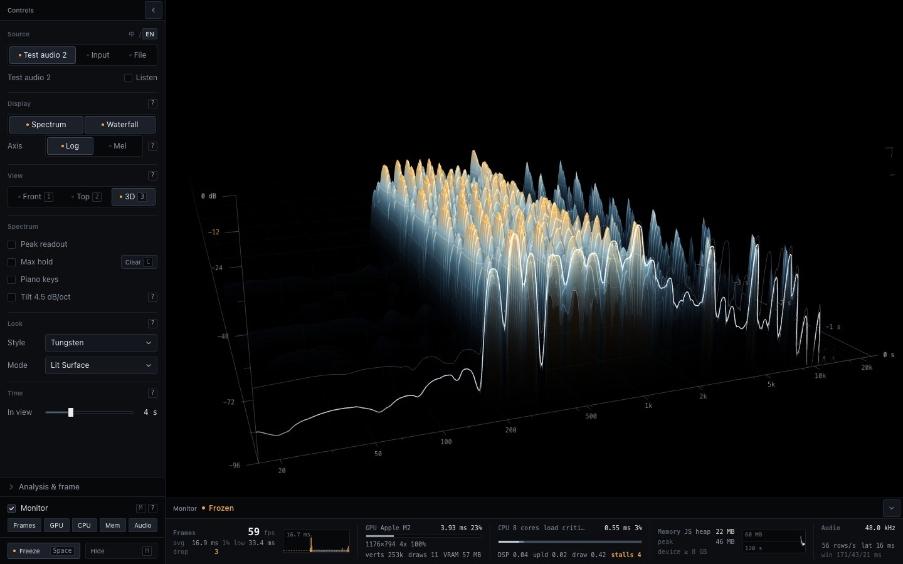
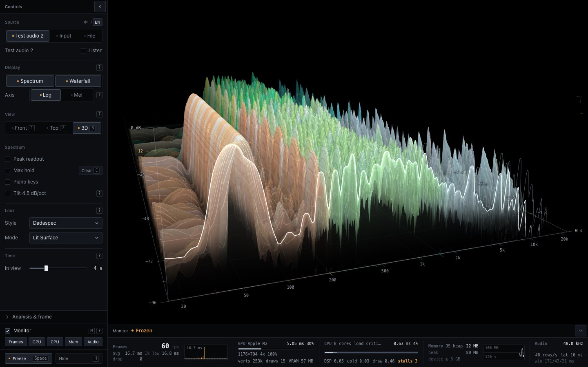
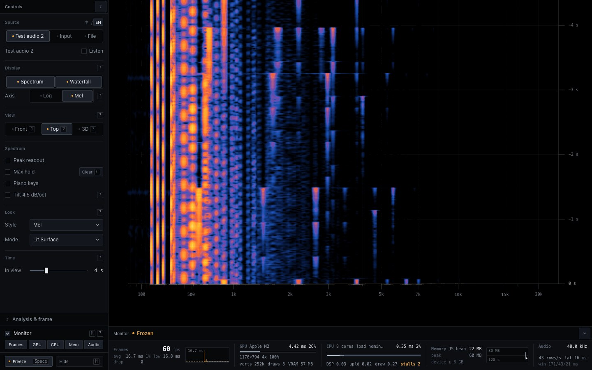
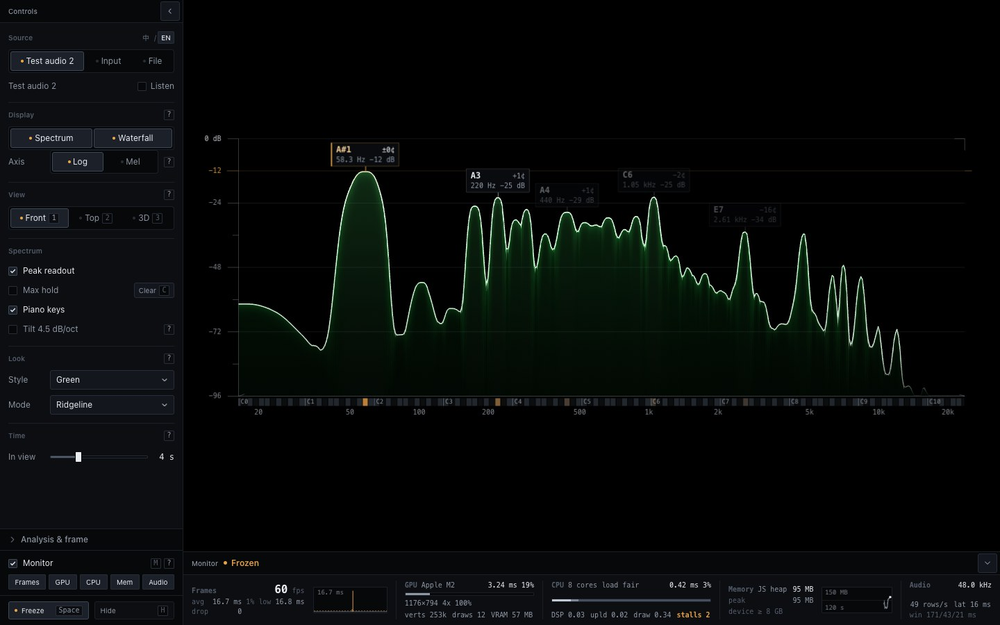

# Spectrum 3D

**English** | [简体中文](docs/README.zh-CN.md) | [日本語](docs/README.ja.md)

[](https://github.com/lawchli/Spectrum-3D/releases)
[](LICENSE)
[](https://github.com/lawchli/Spectrum-3D/actions/workflows/release.yml)

A real-time 3D audio spectrum analyzer for the browser, Android and the desktop. Sound scrolls away from you as a waterfall terrain, with the live spectrum on its front edge. Look at it from the front and it is a spectrum analyzer, from the top a spectrogram, from an angle a landscape.

**[Open it in your browser](https://lawchli.github.io/Spectrum-3D/)**, press **Test audio**, then drag to rotate and scroll to zoom. Nothing to install.



| Dadaspec style, 3D | Mel style, top view on the Mel axis | Green style, front view with peak readout |
|---|---|---|
|  |  |  |

## Features

- Three views: front, top and 3D. Switching between them is a smooth camera move, and you can rotate, pan and zoom freely.
- Pitch at a glance: peak readout with note name and cents, piano keys under the frequency scale, max hold, and an optional 4.5 dB per octave tilt.
- Logarithmic or Mel frequency axis, 60 to 480 spectrum rows per second, 1 to 8 bands per semitone.
- Four styles (Tungsten, Mel, Green, Dadaspec), each drawn as Lit Surface, Ridgeline, Mesh or Solid.
- Sources: built-in test audio, a microphone or audio interface, an audio file. The Android demo app can also capture system audio (Android 10 or later).
- A performance monitor for frame time, GPU and CPU time, memory and audio rate.
- English and Chinese interface.

## Platforms

| | What it is | State |
|---|---|---|
| Web | A WebGL2 page with no dependencies | Beta. Tested in Chrome, Safari and Firefox on macOS and in Chrome on Android |
| Android | A Kotlin / OpenGL ES 3.0 library (AAR) you can embed, and a demo app | Preview. Tested on one phone. No Dadaspec style, Mel axis or tilt yet, no audio files |
| Desktop | A Rust / wgpu program for macOS, Windows and Linux | macOS: beta. Windows and Linux: experimental |

The three share the same GLSL shaders and the same analysis, are checked against each other on 80 reference scenes, and are released together under one version number.

## Download

Get the files from [Releases](https://github.com/lawchli/Spectrum-3D/releases):

| File | For |
|---|---|
| `Spectrum-3D-<version>-macos-universal.zip` | macOS 11 or later, Apple silicon and Intel |
| `Spectrum-3D-<version>-windows-x64.zip` | Windows 10 or later, 64-bit |
| `Spectrum-3D-<version>-linux-x64.tar.gz` | Linux x86-64 with glibc 2.35 or later, for example Ubuntu 22.04 |
| `Spectrum-3D-<version>-android.apk` | The Android demo app, Android 8.0 or later |
| `spectrum-3d-<version>.aar` | The Android library |

The desktop packages are not signed with a paid developer certificate, so the system asks before the first launch:

- **macOS**: unzip, move `Spectrum 3D.app` where you like, right-click it and choose Open. On macOS 15 and later, open it once, then press "Open Anyway" in System Settings, Privacy & Security. Or clear the download mark yourself: `xattr -dr com.apple.quarantine "Spectrum 3D.app"`.
- **Windows**: unzip the whole folder and run `Spectrum 3D.exe`. If SmartScreen appears, choose "More info", then "Run anyway".
- **Linux**: unpack and run `bin/spectrum-3d`. `./install.sh` adds it to your application menu (current user only), `./install.sh --remove` takes it out. It needs a Vulkan or OpenGL driver. On X11 it also needs `libxkbcommon-x11`; on Debian and Ubuntu that is `sudo apt-get install libxkbcommon-x11-0`.

## Use the Android library

Put `spectrum-3d-<version>.aar` in your app's `libs/` folder and add `implementation(files("libs/spectrum-3d-<version>.aar"))`. It needs Android 8.0 (API 26) and OpenGL ES 3.0, has no Compose dependency and asks for no permissions: it records nothing by itself, you feed it PCM.

```kotlin
val spectrum = SpectrumController(context, SpectrumConfiguration(palette = "green"))
val spectrumView = SpectrumView(context, spectrum)  // add it to your layout
spectrum.startPcm(sampleRate = 48000)

// From your player, decoder or capture callback:
spectrum.pushPcm(interleavedStereo, channels = 2)
```

Lifecycle, the Compose wrapper, the capture helpers and the full API are in [android/README.md](android/README.md).

## Build from source

Everything builds from this repository alone. All three parts need [Node.js](https://nodejs.org) 22 or later; there are no packages to install, the scripts only use what Node ships with.

**Web**: a static page with no build step. Serve the `web/` folder with any static file server and open <http://localhost:8765>. The microphone needs a secure context: `localhost` works, any other address must be HTTPS.

```sh
python3 scripts/serve-web.py
```

**Desktop**: needs [Rust](https://rustup.rs) stable.

```sh
bash scripts/wgpu-app.sh               # macOS: rust/target/bundle/Spectrum 3D.app
bash scripts/wgpu-windows-package.sh   # Windows, in Git Bash: rust/target/bundle/Spectrum 3D/
bash scripts/wgpu-linux-package.sh     # Linux: rust/target/bundle/spectrum-3d-linux/
```

On Linux, install the development libraries first (Debian and Ubuntu names):

```sh
sudo apt-get install -y pkg-config libasound2-dev libudev-dev libx11-dev libxcursor-dev libxrandr-dev libxi-dev libxinerama-dev libxkbcommon-dev libwayland-dev libegl1-mesa-dev libgl1-mesa-dev
```

To run it straight from the source tree without packaging:

```sh
node scripts/export-shared.mjs
node scripts/shader-migrate.mjs
cargo run --manifest-path rust/Cargo.toml -p spectrum-wgpu --release
```

**Android**: needs JDK 17 and an Android SDK with `platforms;android-36` and `build-tools;36.0.0`. The library lands in `android/spectrum/build/outputs/aar/`, the demo app in `android/app/build/outputs/apk/debug/`.

```sh
export SPECTRUM_ANDROID_HOME=/path/to/android-sdk
bash scripts/android-build.sh :spectrum:assembleRelease :app:assembleDebug
```

**Tests**:

```sh
node --test tests/analysis.test.mjs tests/monitor.test.mjs
python3 scripts/web-check.py
cargo test --manifest-path rust/Cargo.toml --release
bash scripts/android-build.sh :spectrum:testDebugUnitTest
```

## Known issues

This is a beta.

- **Web on iPhone and iPad**: with the silent switch on, "Listen" makes no sound. Turn silent mode off for now.
- **Web in in-app browsers**: switching away from the page while "Listen" is on can cause a click. Seen in the WeChat and QQ browsers on iOS and Android.
- **Integrated graphics on a 4K display**: the highest settings (480 rows per second, 8 bands per semitone, 4× anti-aliasing) run at about 30 frames per second. A lower render scale, or anti-aliasing off on the desktop, brings it back near 60.
- **Windows**: on Intel UHD 730 the frame rate stays near 33 whatever the settings; on machines with two graphics cards the integrated one is used; dropping a WAV or FLAC file onto the window freezes it (the File button works).
- **Windows and Linux packages** are tested automatically with software rendering, not by hand on real machines.
- **Android** is tested on one phone only (Sony XZ1 Compact, Android 16). Anti-aliasing is off by default because 4× crashed that phone's GPU driver.
- **macOS and Windows packages** are not signed or notarized.

Found something else? [Open an issue](https://github.com/lawchli/Spectrum-3D/issues).

## License and credits

Spectrum 3D is released under the [MIT License](LICENSE).

The Dadaspec style takes its name and its coloring idea from [dadaspec](https://github.com/dada-bots/dadaspec) by dadabots (MIT License). No dadaspec code is included, and this project is not affiliated with dadabots. See [THIRD-PARTY-NOTICES.md](THIRD-PARTY-NOTICES.md). The desktop packages list the licenses of the Rust crates they are built from in `THIRD-PARTY-LICENSES.txt`.
