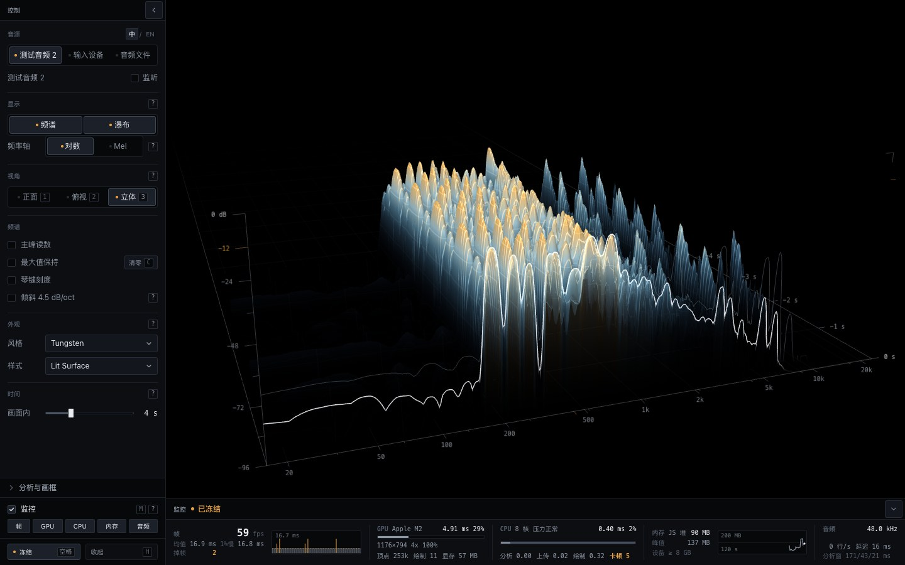
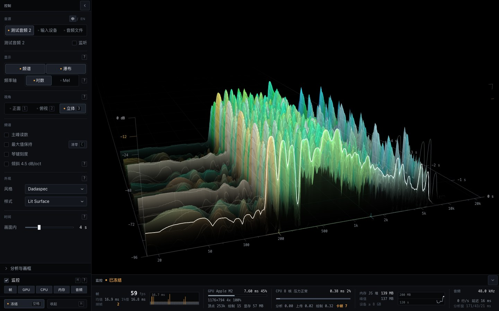
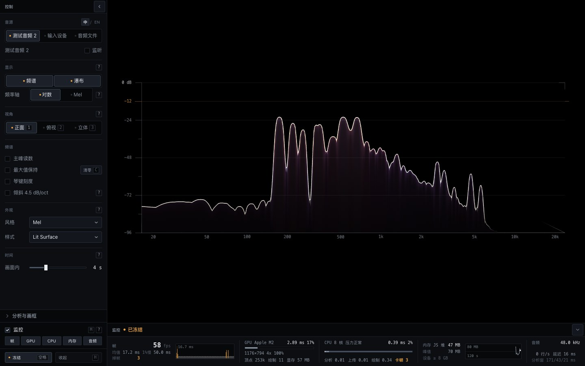
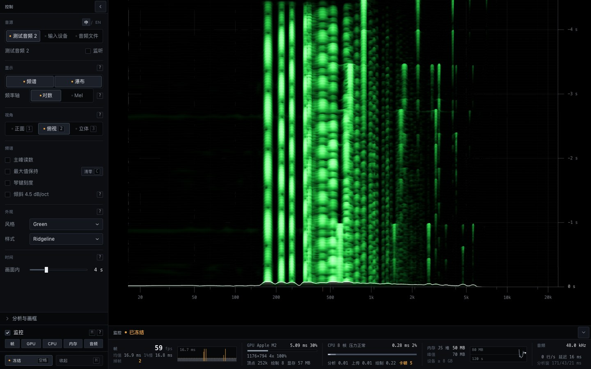
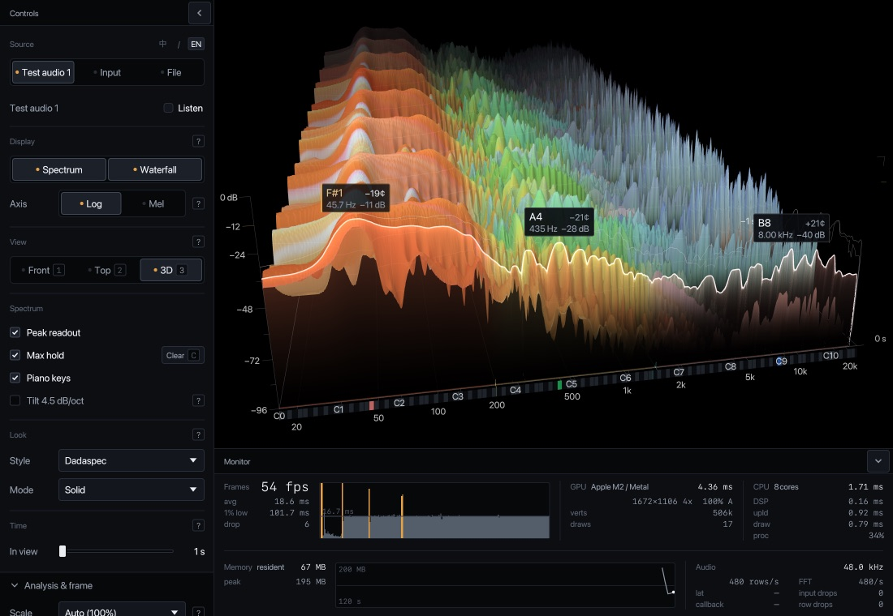

# Spectrum 3D

A real-time 3D audio spectrum analyser. Sound becomes a waterfall terrain on a black stage, with the live 2D spectrum on its leading edge. Drag to rotate, scroll to zoom; the front, top and 3D views blend into one another.

**Try it in your browser: <https://lawchli.github.io/Spectrum-3D/>.** Press "Test audio", or pick an input device or an audio file.

[中文说明](README.zh-CN.md)



| Dadaspec style | Mel style, front view |
|---|---|
|  |  |

| Green style, top view | Desktop program on macOS |
|---|---|
|  |  |

## What is here

One design in three implementations. They share the same GLSL shaders, the same look constants and the same analysis, checked against each other with 80 reference scenes.

| Part | What it is | State in 0.3.0-beta.1 |
|---|---|---|
| Web (`web/`) | A zero-dependency WebGL2 page | Beta. Tested in Chrome, Safari and Firefox on macOS and in Chrome on Android |
| Android (`android/`) | A Kotlin / OpenGL ES 3.0 library (AAR) you can embed, plus a demo app | Preview. Tested on one phone |
| Desktop (`rust/`) | A Rust / wgpu program | macOS: beta. Windows and Linux: **experimental** |

Every release carries one version number for all three. The files are on the [Releases](https://github.com/lawchli/Spectrum-3D/releases) page:

| File | For |
|---|---|
| `Spectrum-3D-<version>-macos-universal.zip` | macOS 11 or later, Apple silicon and Intel |
| `Spectrum-3D-<version>-windows-x64.zip` | Windows 10 or later, 64-bit (experimental) |
| `Spectrum-3D-<version>-linux-x64.tar.gz` | Linux x86-64 with glibc 2.35 or later, for example Ubuntu 22.04 (experimental) |
| `Spectrum-3D-<version>-android.apk` | The Android demo app, Android 8.0 or later |
| `spectrum-3d-<version>.aar` | The Android library |

None of the desktop packages is signed with a paid developer certificate, so the system warns on first launch:

- **macOS**: unzip, move `Spectrum 3D.app` where you want it, then right-click it and choose Open. On macOS 15 and later, open it once, then go to System Settings, Privacy & Security, and press "Open Anyway". Or remove the download mark yourself: `xattr -dr com.apple.quarantine "Spectrum 3D.app"`.
- **Windows**: unzip the whole folder and run `Spectrum 3D.exe`. If SmartScreen appears, choose "More info", then "Run anyway".
- **Linux**: unpack and run `bin/spectrum-3d`. `./install.sh` adds a launcher with the icon to your application menu (current user only), `./install.sh --remove` takes it out again. It needs a Vulkan or OpenGL driver and, on X11, the `libxkbcommon-x11` library (`sudo apt-get install libxkbcommon-x11-0` on Debian and Ubuntu if it reports that the library could not be loaded).

## Features

- Three views (front, top, 3D) with free rotation, pan and zoom.
- Four styles: Tungsten, Mel, Green and Dadaspec, each with four drawing modes (Lit Surface, Ridgeline, Mesh, Solid). Android has the first three styles.
- Logarithmic or Mel frequency axis (web and desktop).
- 60 to 480 spectrum rows per second and 1 to 8 bands per semitone.
- Peak readout with note name and cents, max hold, piano keys on the scale, and a 4.5 dB per octave tilt for the front view.
- Sources: built-in test audio, an input device (microphone or audio interface), an audio file (web and desktop), system audio capture (Android demo, Android 10 or later).
- A performance monitor: frame times, GPU time, CPU time, memory, audio rate.
- Chinese and English interface.

## Run the web version yourself

It is a static page with no build step. Serve the `web/` folder with any static file server, for example:

```sh
python3 scripts/serve-web.py
```

and open <http://localhost:8765>. The microphone and the audio worklet need a secure context: `localhost` counts, any other address must be HTTPS.

## Use the Android library

Add `spectrum-3d-<version>.aar` to your app's `libs/` folder and `implementation(files("libs/spectrum-3d-<version>.aar"))` to its dependencies. The library needs Android 8.0 (API 26) and OpenGL ES 3.0. It does not depend on Compose, and it declares no recording, notification or foreground-service permission: by default it captures nothing and you push your own PCM.

```kotlin
private lateinit var spectrum: SpectrumController
private lateinit var spectrumView: SpectrumView

override fun onCreate(savedInstanceState: Bundle?) {
    super.onCreate(savedInstanceState)
    spectrum = SpectrumController(this, SpectrumConfiguration(
        palette = "green",
        view = "perspective",
        rowRate = 120,
        bandsPerSemitone = 2,
    ))
    spectrumView = SpectrumView(this, spectrum)
    setContentView(spectrumView)
    spectrum.startPcm(sampleRate = 48000)
}

// Push Float32 PCM from your own player, decoder or capture callback.
fun onAudioBlock(interleavedStereo: FloatArray) {
    spectrum.pushPcm(interleavedStereo, channels = 2)
}

override fun onResume() { super.onResume(); spectrumView.onResume() }
override fun onPause() { spectrumView.onPause(); super.onPause() }
override fun onDestroy() { spectrum.dispose(); super.onDestroy() }
```

The Compose wrapper, the capture helpers and the full API are in [android/README.md](android/README.md). The demo app in `android/app` shows the permissions, the microphone, system audio capture and the notification.

## Build from source

Everything builds from this repository alone. You need [Node.js](https://nodejs.org) 22 or later for all three parts: it has no packages to install, the scripts only use what Node ships with.

**Web**: nothing to build.

**Desktop**: [Rust](https://rustup.rs) stable.

```sh
bash scripts/wgpu-app.sh               # macOS: rust/target/bundle/Spectrum 3D.app
bash scripts/wgpu-windows-package.sh   # Windows, in Git Bash: rust/target/bundle/Spectrum 3D/
bash scripts/wgpu-linux-package.sh     # Linux: rust/target/bundle/spectrum-3d-linux/
```

On Linux install the development libraries first (Debian and Ubuntu names):

```sh
sudo apt-get install -y pkg-config libasound2-dev libudev-dev libx11-dev libxcursor-dev libxrandr-dev libxi-dev libxinerama-dev libxkbcommon-dev libwayland-dev libegl1-mesa-dev libgl1-mesa-dev
```

To run it straight from the source tree instead of packaging it:

```sh
node scripts/export-shared.mjs
node scripts/shader-migrate.mjs
cargo run --manifest-path rust/Cargo.toml -p spectrum-wgpu --release
```

**Android**: JDK 17 and an Android SDK with `platforms;android-36` and `build-tools;36.0.0`.

```sh
export SPECTRUM_ANDROID_HOME=/path/to/android-sdk
bash scripts/android-build.sh :spectrum:assembleRelease :app:assembleDebug
```

The library lands in `android/spectrum/build/outputs/aar/`, the demo app in `android/app/build/outputs/apk/debug/`.

**Tests**:

```sh
node --test tests/analysis.test.mjs tests/monitor.test.mjs
python3 scripts/web-check.py
cargo test --manifest-path rust/Cargo.toml --release
bash scripts/android-build.sh :spectrum:testDebugUnitTest
```

## Known issues

This is a beta. What is known not to work well:

| Issue | Where |
|---|---|
| On integrated graphics driving a 4K display, the highest settings (480 rows per second, 8 bands per semitone, 4× anti-aliasing) run at about 30 frames per second. A lower render scale, or anti-aliasing off on desktop, brings it back near 60 | Web, desktop |
| On Intel UHD 730 the frame rate stayed near 33 whatever the settings | Windows desktop |
| On a machine with two graphics cards the program picks the integrated one | Windows desktop |
| Dropping a WAV or FLAC file onto the window froze it. MP3 by drag and drop, and every format through the "File" button, worked | Windows desktop |
| The Windows and Linux packages are built from code that was last run on real Windows and Linux desktops a few changes ago. They are built, unit-tested and smoke-tested with software rendering automatically, not hand-tested | Windows, Linux desktop |
| Tested on one phone only (Sony XZ1 Compact, Android 16). 4× anti-aliasing crashed its GPU driver, so the default is off | Android |
| No Dadaspec style, no Mel axis and no tilt yet | Android |
| The packages are not signed or notarised | macOS, Windows |

## Roadmap

Not promises, but the direction:

- Split the Rust renderer into a library that other wgpu programs can embed.
- A VST and Audio Unit plug-in on top of that library.
- A native Metal version for iOS and macOS.
- Bring the Android library level with the web version (Mel axis, tilt, peak tracking, Dadaspec).
- Better defaults on integrated graphics, and a DirectX 12 option on Windows.

## Licence and credits

Spectrum 3D is released under the [MIT licence](LICENSE).

The Dadaspec style takes its name and its colouring idea from [dadaspec](https://github.com/dada-bots/dadaspec) by dadabots (MIT licence). No dadaspec code is included, and this project is not affiliated with dadabots. See [THIRD-PARTY-NOTICES.md](THIRD-PARTY-NOTICES.md). The desktop packages carry the licences of the Rust crates they are built from in `THIRD-PARTY-LICENSES.txt`.
