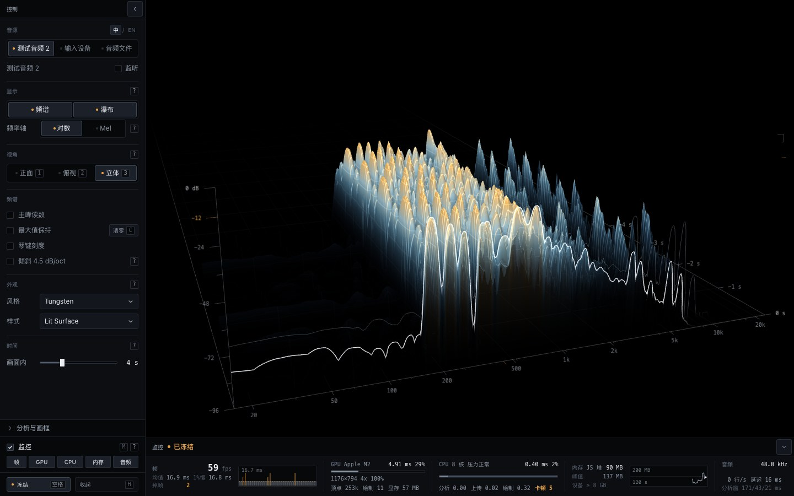

# Spectrum 3D

实时三维音频频谱仪。声音变成黑底上的瀑布地形，最前沿是当前的二维频谱。拖动旋转，滚轮缩放；正面、俯视、立体三个视角之间平滑过渡。

**在浏览器里直接试：<https://lawchli.github.io/Spectrum-3D/>。** 点"测试音频"，或者选输入设备、音频文件。

[English](README.md)



## 这里有什么

同一套设计的三种实现，共用同一份 GLSL 着色器、同一份外观常数和同一套分析算法，用 80 组参考场景互相对照。

| 部分 | 是什么 | 0.3.0-beta.1 的状态 |
|---|---|---|
| 网页版（`web/`） | 零依赖的 WebGL2 页面 | Beta。在 macOS 的 Chrome、Safari、Firefox 和安卓的 Chrome 上测过 |
| 安卓（`android/`） | 可以嵌进自己 App 的 Kotlin / OpenGL ES 3.0 组件库（AAR），加一个演示 App | 预览。只在一台手机上测过 |
| 桌面版（`rust/`） | Rust / wgpu 程序 | macOS：Beta。Windows 和 Linux：**实验性** |

每次发布，三端用同一个版本号。文件在 [Releases](https://github.com/lawchli/Spectrum-3D/releases) 页面：

| 文件 | 给谁 |
|---|---|
| `Spectrum-3D-<版本>-macos-universal.zip` | macOS 11 及以上，Apple 芯片和 Intel 都能用 |
| `Spectrum-3D-<版本>-windows-x64.zip` | 64 位 Windows 10 及以上（实验性） |
| `Spectrum-3D-<版本>-linux-x64.tar.gz` | x86-64 Linux，glibc 2.35 及以上，例如 Ubuntu 22.04（实验性） |
| `Spectrum-3D-<版本>-android.apk` | 安卓演示 App，Android 8.0 及以上 |
| `spectrum-3d-<版本>.aar` | 安卓组件库 |

桌面版的安装包都没有付费的开发者签名，第一次打开系统会拦一下：

- **macOS**：解压，把 `Spectrum 3D.app` 放到想放的地方，右键点它选"打开"。macOS 15 及以上：先打开一次，再到"系统设置"的"隐私与安全性"里点"仍要打开"。也可以自己去掉下载标记：`xattr -dr com.apple.quarantine "Spectrum 3D.app"`。
- **Windows**：把整个文件夹解压出来，运行 `Spectrum 3D.exe`。出现 SmartScreen 时点"更多信息"，再点"仍要运行"。
- **Linux**：解压后运行 `bin/spectrum-3d`。`./install.sh` 会在应用菜单里加一个带图标的启动项（只对当前用户），`./install.sh --remove` 撤掉。

## 功能

- 正面、俯视、立体三个视角，可以自由旋转、平移、缩放。
- 四套风格：Tungsten、Mel、Green、Dadaspec，每套有四种绘图样式（Lit Surface、Ridgeline、Mesh、Solid）。安卓有前三套。
- 对数或 Mel 频率轴（网页和桌面）。
- 每秒 60 到 480 行频谱，每半音 1 到 8 段。
- 主峰读数（音名和音分）、最大值保持、琴键刻度、正面视角的 4.5 dB/oct 倾斜。
- 音源：内置测试音频、输入设备（麦克风或声卡）、音频文件（网页和桌面）、系统内录（安卓演示 App，Android 10 及以上）。
- 性能监控：帧时间、GPU 时间、CPU 时间、内存、音频行率。
- 中英文界面。

## 自己跑网页版

网页版是静态页面，不需要构建。用任何静态文件服务器把 `web/` 目录发出去就行，例如：

```sh
python3 scripts/serve-web.py
```

然后打开 <http://localhost:8765>。麦克风和 AudioWorklet 要求安全环境：`localhost` 算，其他地址必须是 HTTPS。

## 用安卓组件库

把 `spectrum-3d-<版本>.aar` 放进 App 的 `libs/` 目录，依赖里加 `implementation(files("libs/spectrum-3d-<版本>.aar"))`。库要求 Android 8.0（API 26）和 OpenGL ES 3.0，不依赖 Compose，也不声明录音、通知、前台服务权限：默认什么都不采集，由你把自己的 PCM 推进来。

```kotlin
private lateinit var spectrum: SpectrumController
private lateinit var spectrumView: SpectrumView

override fun onCreate(savedInstanceState: Bundle?) {
    super.onCreate(savedInstanceState)
    spectrum = SpectrumController(this, SpectrumConfiguration(
        palette = "green",
        view = "perspective",
        rowRate = 120,
        bandsPerSemitone = 2,
    ))
    spectrumView = SpectrumView(this, spectrum)
    setContentView(spectrumView)
    spectrum.startPcm(sampleRate = 48000)
}

// 从自己的播放器、解码器或采集回调推送 Float32 PCM。
fun onAudioBlock(interleavedStereo: FloatArray) {
    spectrum.pushPcm(interleavedStereo, channels = 2)
}

override fun onResume() { super.onResume(); spectrumView.onResume() }
override fun onPause() { spectrumView.onPause(); super.onPause() }
override fun onDestroy() { spectrum.dispose(); super.onDestroy() }
```

Compose 的包法、采集的辅助入口和完整接口见 [android/README.md](android/README.md)。`android/app` 里的演示 App 展示了权限、麦克风、系统内录和通知怎么接。

## 从源码编译

只靠这个仓库就能全部编译出来。三部分都要 [Node.js](https://nodejs.org) 22 及以上：不用装任何包，脚本只用 Node 自带的东西。

**网页版**：不用编译。

**桌面版**：[Rust](https://rustup.rs) stable。

```sh
bash scripts/wgpu-app.sh               # macOS：rust/target/bundle/Spectrum 3D.app
bash scripts/wgpu-windows-package.sh   # Windows，在 Git Bash 里：rust/target/bundle/Spectrum 3D/
bash scripts/wgpu-linux-package.sh     # Linux：rust/target/bundle/spectrum-3d-linux/
```

Linux 上先装开发库（Debian、Ubuntu 的包名）：

```sh
sudo apt-get install -y pkg-config libasound2-dev libudev-dev libx11-dev libxcursor-dev libxrandr-dev libxi-dev libxinerama-dev libxkbcommon-dev libwayland-dev libegl1-mesa-dev libgl1-mesa-dev
```

不打包、直接从源码目录运行：

```sh
node scripts/export-shared.mjs
node scripts/shader-migrate.mjs
cargo run --manifest-path rust/Cargo.toml -p spectrum-wgpu --release
```

**安卓**：JDK 17，Android SDK 里要有 `platforms;android-36` 和 `build-tools;36.0.0`。

```sh
export SPECTRUM_ANDROID_HOME=/path/to/android-sdk
bash scripts/android-build.sh :spectrum:assembleRelease :app:assembleDebug
```

组件库在 `android/spectrum/build/outputs/aar/`，演示 App 在 `android/app/build/outputs/apk/debug/`。

**测试**：

```sh
node --test tests/analysis.test.mjs tests/monitor.test.mjs
python3 scripts/web-check.py
cargo test --manifest-path rust/Cargo.toml --release
bash scripts/android-build.sh :spectrum:testDebugUnitTest
```

## 已知问题

这是 Beta 版。已经知道不好用的地方：

| 问题 | 哪里 |
|---|---|
| 核显接 4K 屏时，最高档（每秒 480 行、每半音 8 段、4 倍抗锯齿）只有约 30 帧。降低渲染比例，或者桌面版关掉抗锯齿，能回到接近 60 帧 | 网页、桌面 |
| Intel UHD 730 上帧率一直在 33 帧左右，和设置无关 | Windows 桌面 |
| 有两块显卡的机器会选到核显 | Windows 桌面 |
| 把 WAV 或 FLAC 文件拖进窗口会卡死。拖 MP3、用"音频文件"按钮选任何格式都正常 | Windows 桌面 |
| Windows、Linux 的安装包所用的代码，上一次在这两个系统上实际运行是几次改动之前。它们由自动流程编译和跑单元测试，没有人工测过 | Windows、Linux 桌面 |
| 只在一台手机上测过（Sony XZ1 Compact，Android 16）。4 倍抗锯齿会让它的 GPU 驱动崩溃，所以默认关 | 安卓 |
| 还没有 Dadaspec 风格、Mel 轴和倾斜 | 安卓 |
| 安装包没有签名和公证 | macOS、Windows |

## 路线图

不是承诺，是方向：

- 把 Rust 渲染器拆成库，让别的 wgpu 程序能嵌进去。
- 在这个库上做 VST 和 Audio Unit 插件。
- iOS 和 macOS 的原生 Metal 版。
- 安卓组件库补齐到和网页版一样（Mel 轴、倾斜、主峰跟踪、Dadaspec）。
- 核显上更合适的默认值，Windows 上可选 DirectX 12。

## 许可和致谢

Spectrum 3D 以 [MIT 许可](LICENSE)发布。

Dadaspec 风格的名字和上色思路来自 dadabots 的 [dadaspec](https://github.com/dada-bots/dadaspec)（MIT 许可）。这里没有包含 dadaspec 的代码，本项目和 dadabots 没有关系。见 [THIRD-PARTY-NOTICES.md](THIRD-PARTY-NOTICES.md)。桌面版安装包里的 `THIRD-PARTY-LICENSES.txt` 是所用 Rust 库的许可原文。
