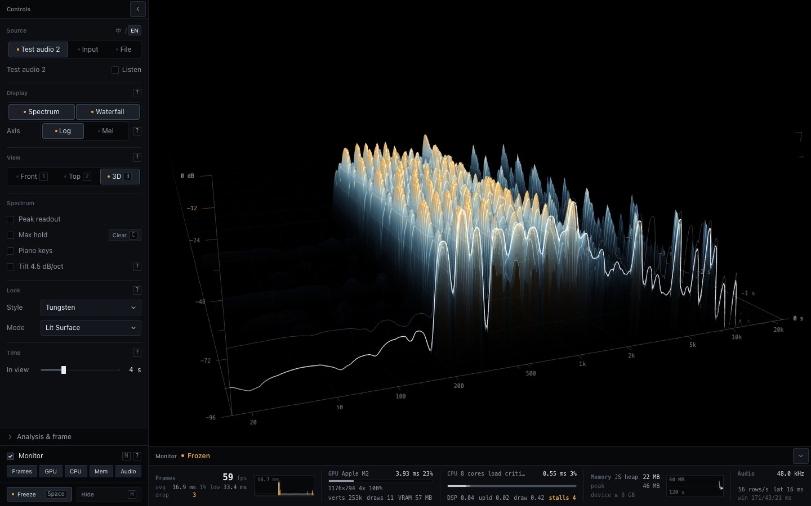
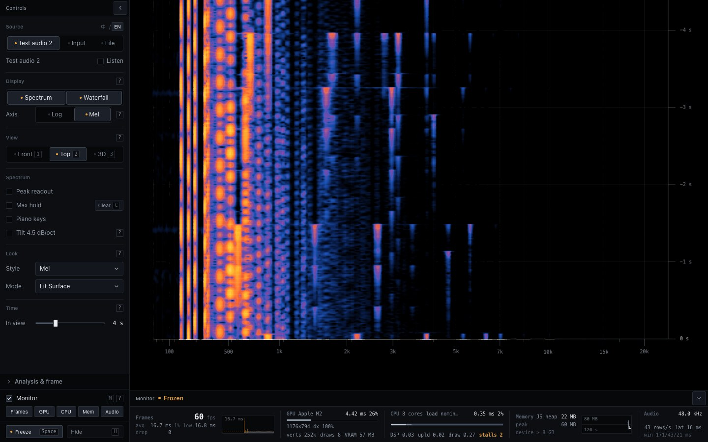
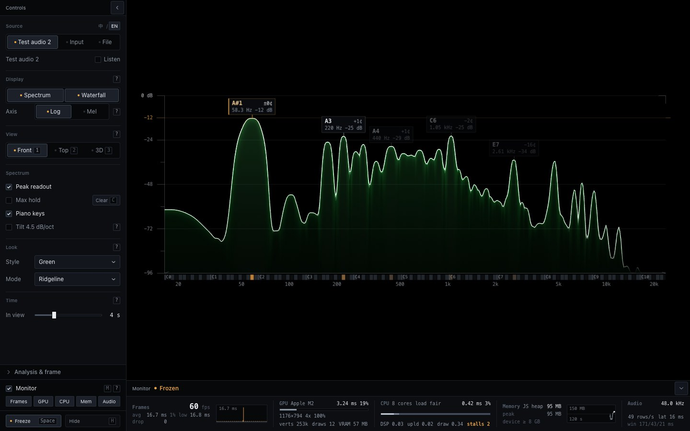

# Spectrum 3D

[English](../README.md) | [简体中文](README.zh-CN.md) | **日本語**

[](https://github.com/lawchli/Spectrum-3D/releases)
[](../LICENSE)
[](https://github.com/lawchli/Spectrum-3D/actions/workflows/release.yml)

ブラウザ、Android、デスクトップで動くリアルタイムの3Dオーディオスペクトラムアナライザーです。鳴っている音が奥へと流れてウォーターフォール状の地形になり、その手前の縁に現在のスペクトラムがリアルタイムで描かれます。正面から見るとスペクトラムアナライザー、真上から見るとスペクトログラム、斜めから見ると一つの地形のように見えます。

インストールは不要です。[**ブラウザで開く**](https://lawchli.github.io/Spectrum-3D/)からページを開いたら、「**Test audio**」を押して、ドラッグで回転・スクロールでズームしてみてください。



| Dadaspecスタイル（3D） | Melスタイル（上面ビュー、Mel軸） | Greenスタイル（正面ビュー、ピーク表示付き） |
|---|---|---|
|  |  |  |

## 機能

- 視点は正面・上面・3Dの3種類です。切り替えるときはカメラが滑らかに移動し、その状態から自由に回転・パン・ズームできます。
- 音程もひと目で追えます。ピーク位置のノート名とセント値の表示、周波数目盛りの下に並ぶピアノ鍵盤、最大値ホールドに加え、必要に応じて1オクターブあたり4.5 dBのチルトもかけられます。
- 周波数軸は対数とMelから選べて、スペクトラムは毎秒60〜480行、半音あたり1〜8バンドまで切り替えられます。
- 見た目のスタイルはTungsten、Mel、Green、Dadaspecの4種類で、それぞれLit Surface、Ridgeline、Mesh、Solidの描き方が選べます。
- 音源は内蔵テストオーディオ、マイクやオーディオインターフェース、オーディオファイルの3つです。Androidのデモアプリではシステムオーディオのキャプチャもできます（Android 10以降）。
- フレーム時間、GPUとCPUの処理時間、メモリ、オーディオレートを確認できるパフォーマンスモニターも付いています。
- 画面の言語は英語と中国語のみです（日本語の表示には未対応）。

## プラットフォーム

| | 内容 | 状況 |
|---|---|---|
| Web | 外部ライブラリを使わないWebGL2のページ | ベータ版。macOSのChrome・Safari・Firefox、AndroidのChromeでテスト済み |
| Android | 組み込み用のKotlin / OpenGL ES 3.0ライブラリ（AAR）と、デモアプリ | プレビュー版。1台のスマホでしかテストできていません。Dadaspecスタイル、Mel軸、チルト、オーディオファイルにはまだ対応していません |
| Desktop | macOS、Windows、Linux向けのRust / wgpu製プログラム | macOSはベータ版、WindowsとLinuxは実験的な段階です |

この3つは同じGLSLシェーダーと解析処理を使っており、80種類の参照シーンで結果が一致するかを互いに突き合わせて確認しています。リリースも3つまとめて同じバージョン番号で出しています。

## ダウンロード

ファイルは[Releases](https://github.com/lawchli/Spectrum-3D/releases)からダウンロードできます。

| ファイル | 対象 |
|---|---|
| `Spectrum-3D-<version>-macos-universal.zip` | macOS 11以降（Apple silicon・Intel両対応） |
| `Spectrum-3D-<version>-windows-x64.zip` | Windows 10以降（64ビット） |
| `Spectrum-3D-<version>-linux-x64.tar.gz` | glibc 2.35以降のLinux x86-64（Ubuntu 22.04など） |
| `Spectrum-3D-<version>-android.apk` | Androidデモアプリ（Android 8.0以降） |
| `spectrum-3d-<version>.aar` | Androidライブラリ |

デスクトップ版は有料の開発者証明書で署名していないため、初回起動時にOSの確認ダイアログが出ます。

- **macOS**：ZIPを解凍して`Spectrum 3D.app`を好きな場所へ移し、右クリックから「開く」を選んでください。macOS 15以降では一度開こうとしたあと、「システム設定」の「プライバシーとセキュリティ」にある「このまま開く」を押す必要があります。`xattr -dr com.apple.quarantine "Spectrum 3D.app"`を実行して、ダウンロード時の隔離属性を自分で消しても構いません。
- **Windows**：フォルダごとすべて解凍してから`Spectrum 3D.exe`を実行してください。SmartScreenが出た場合は「詳細情報」をクリックし、そのあと「実行」を選びます。
- **Linux**：展開した中にある`bin/spectrum-3d`を実行します。`./install.sh`を実行すればアプリケーションメニューに登録され（現在のユーザーのみ）、`./install.sh --remove`で外せます。動作にはVulkanまたはOpenGLのドライバーが必要です。X11環境では`libxkbcommon-x11`も要るため、DebianやUbuntuなら`sudo apt-get install libxkbcommon-x11-0`で入れてください。

## Androidライブラリの使い方

アプリの`libs/`フォルダに`spectrum-3d-<version>.aar`を入れて、依存関係に`implementation(files("libs/spectrum-3d-<version>.aar"))`を追加してください。必要な環境はAndroid 8.0（API 26）とOpenGL ES 3.0です。Composeには依存しておらず、権限も一切求めません。ライブラリ側で勝手に録音することはないので、呼び出し元からPCMデータを流し込んで使います。

```kotlin
val spectrum = SpectrumController(context, SpectrumConfiguration(palette = "green"))
val spectrumView = SpectrumView(context, spectrum)  // レイアウトに追加
spectrum.startPcm(sampleRate = 48000)

// プレイヤーやデコーダー、録音コールバックなどから渡す：
spectrum.pushPcm(interleavedStereo, channels = 2)
```

ライフサイクルとの連携やComposeラッパー、音声キャプチャ用のヘルパー、API全体のリファレンスは[android/README.md](../android/README.md)（英語）にまとめてあります。

## ソースからのビルド

必要なものはすべてこのリポジトリに揃っています。3つとも[Node.js](https://nodejs.org) 22以降が必要ですが、スクリプトはNode標準のモジュールだけで動くため、追加パッケージのインストールは要りません。

**Web**：ビルドの要らない静的ページなので、静的ファイルサーバーで`web/`フォルダを配信して<http://localhost:8765>を開けば動きます。ただしマイク入力にはセキュアコンテキストが要るため、`localhost`以外のアドレスを使う場合はHTTPSにしてください。

```sh
python3 scripts/serve-web.py
```

**Desktop**：[Rust](https://rustup.rs)のstableツールチェインが必要です。

```sh
bash scripts/wgpu-app.sh               # macOS：rust/target/bundle/Spectrum 3D.app
bash scripts/wgpu-windows-package.sh   # Windows（Git Bash上で実行）：rust/target/bundle/Spectrum 3D/
bash scripts/wgpu-linux-package.sh     # Linux：rust/target/bundle/spectrum-3d-linux/
```

Linuxでは先に開発用ライブラリを入れておいてください（以下はDebian・Ubuntuでのパッケージ名です）。

```sh
sudo apt-get install -y pkg-config libasound2-dev libudev-dev libx11-dev libxcursor-dev libxrandr-dev libxi-dev libxinerama-dev libxkbcommon-dev libwayland-dev libegl1-mesa-dev libgl1-mesa-dev
```

パッケージを作らずソースツリーからそのまま走らせる場合は、次の3つを実行します。

```sh
node scripts/export-shared.mjs
node scripts/shader-migrate.mjs
cargo run --manifest-path rust/Cargo.toml -p spectrum-wgpu --release
```

**Android**：JDK 17と、`platforms;android-36`および`build-tools;36.0.0`が入ったAndroid SDKが必要です。ビルドするとライブラリは`android/spectrum/build/outputs/aar/`に、デモアプリは`android/app/build/outputs/apk/debug/`に出力されます。

```sh
export SPECTRUM_ANDROID_HOME=/path/to/android-sdk
bash scripts/android-build.sh :spectrum:assembleRelease :app:assembleDebug
```

**テスト**：

```sh
node --test tests/analysis.test.mjs tests/monitor.test.mjs
python3 scripts/web-check.py
cargo test --manifest-path rust/Cargo.toml --release
bash scripts/android-build.sh :spectrum:testDebugUnitTest
```

## 既知の問題

現在はベータ版です。

- **iPhone・iPadのWeb版**：本体の消音スイッチ（サイレントスイッチ）がオンのままだと、「Listen」をオンにしても音が出ません。今のところは消音モードを切って使ってください。
- **アプリ内ブラウザのWeb版**：「Listen」がオンの状態で別の画面へ切り替えると、クリック音（ノイズ）が鳴ることがあります。iOSとAndroidのWeChatやQQのブラウザで確認されています。
- **内蔵GPUで4Kディスプレイに出す場合**：最高設定（毎秒480行、半音あたり8バンド、4×アンチエイリアシング）にすると30 fps前後に落ちます。レンダースケールを下げるか、デスクトップ版ならアンチエイリアシングを切ると60 fps近くまで戻ります。
- **Windows**：Intel UHD 730環境では設定を変えてもフレームレートが33 fps前後から上がりません。また、GPUを2基積んでいるマシンでは内蔵GPU側が選ばれてしまいます。WAVやFLACファイルをウィンドウにドロップすると固まりますが、「File」ボタンから選べば普通に開けます。
- **WindowsとLinuxのパッケージ**は、自動テストの中でソフトウェアレンダリングを使って動かしただけで、実機での手動テストはできていません。
- **Android**は手元の1台（Sony XZ1 Compact、Android 16）でしかテストしていません。4×アンチエイリアシングを有効にしたらこの機種のGPUドライバーが落ちたので、デフォルトではオフにしています。
- **macOSとWindowsのパッケージ**には、署名も公証もしていません。

ほかにも問題を見つけたら、[Issueで教えてください](https://github.com/lawchli/Spectrum-3D/issues)。

## ライセンスとクレジット

Spectrum 3Dは[MITライセンス](../LICENSE)で公開しています。

Dadaspecスタイルの名前と色分けのアイデアは、dadabotsの[dadaspec](https://github.com/dada-bots/dadaspec)（MITライセンス）から借りました。dadaspecのコードは含まれておらず、dadabotsとの提携・関係はありません。詳しくは[THIRD-PARTY-NOTICES.md](../THIRD-PARTY-NOTICES.md)を確認してください。なお、デスクトップ版のパッケージには、ビルドに使っているRustクレートのライセンスをまとめた`THIRD-PARTY-LICENSES.txt`を同梱しています。
