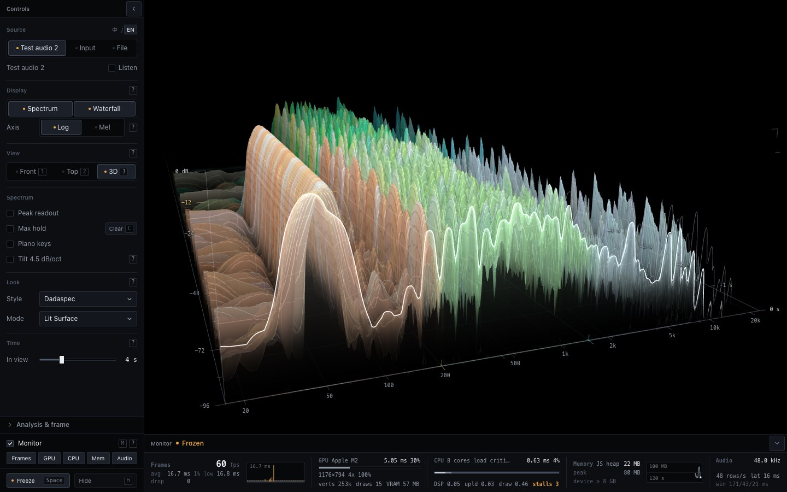

# Spectrum 3D

[English](../README.md) | [简体中文](README.zh-CN.md) | **日本語**

[](https://github.com/lawchli/Spectrum-3D/releases)
[](../LICENSE)
[](https://github.com/lawchli/Spectrum-3D/actions/workflows/release.yml)

ブラウザ、Android、デスクトップ向けのリアルタイム3Dオーディオスペクトラムアナライザーです。音はウォーターフォール状の地形となって奥へと流れていき、手前の縁に現在のスペクトラムがリアルタイムで描かれます。正面から見ればスペクトラムアナライザー、真上から見ればスペクトログラム、斜めから見ればひとつの風景になります。

**[ブラウザで開く](https://lawchli.github.io/Spectrum-3D/)** にアクセスして **Test audio** を押し、ドラッグで回転、スクロールでズームしてみてください。インストールは不要です。


<p>
  
  
  
</p>

左から順に、3DのDadaspecスタイル、Mel軸で真上から見たMelスタイル、ピーク表示とピアノ鍵盤付きで正面から見たGreenスタイルです。

## 機能

- 正面・上面・3Dの3つのビュー。切り替え時はカメラが滑らかに移動し、自由に回転・パン・ズームできます。
- 音程をひと目で把握：音名とセント値付きのピーク表示、周波数目盛りの下のピアノ鍵盤、最大値ホールド、オプションの1オクターブあたり4.5 dBのチルト。
- 対数またはMelの周波数軸、毎秒60〜480行のスペクトラム、半音あたり1〜8バンド。
- 4つのスタイル（Tungsten、Mel、Green、Dadaspec）。それぞれLit Surface、Ridgeline、Mesh、Solidとして描画できます。
- 音源：内蔵テストオーディオ、マイクまたはオーディオインターフェース、オーディオファイル。Androidデモアプリではシステムオーディオのキャプチャも可能です（Android 10以降）。
- フレーム時間、GPU・CPU時間、メモリ、オーディオレートを確認できるパフォーマンスモニター。
- 英語と中国語のインターフェース。

## プラットフォーム

| | 概要 | 状況 |
|---|---|---|
| Web | 外部依存のないWebGL2ページ | ベータ版。macOSのChrome・Safari・Firefox、およびAndroidのChromeでテスト済み |
| Android | 組み込み可能なKotlin / OpenGL ES 3.0ライブラリ（AAR）とデモアプリ | プレビュー版。1台のスマートフォンでテスト済み。Dadaspecスタイル、Mel軸、チルト、オーディオファイルには未対応 |
| Desktop | macOS、Windows、Linux向けのRust / wgpuプログラム | macOS：ベータ版。Windows・Linux：実験的 |

これら3つは共通のGLSLシェーダーと同じ解析処理を使用しており、80種類の参照シーンで相互に検証され、単一のバージョン番号でまとめてリリースされています。

## ダウンロード

[Releases](https://github.com/lawchli/Spectrum-3D/releases)からファイルをダウンロードできます：

| ファイル | 対象 |
|---|---|
| `Spectrum-3D-<version>-macos-universal.zip` | macOS 11以降（Apple siliconおよびIntel） |
| `Spectrum-3D-<version>-windows-x64.zip` | Windows 10以降（64ビット） |
| `Spectrum-3D-<version>-linux-x64.tar.gz` | glibc 2.35以降のLinux x86-64（Ubuntu 22.04など） |
| `Spectrum-3D-<version>-android.apk` | Androidデモアプリ（Android 8.0以降） |
| `spectrum-3d-<version>.aar` | Androidライブラリ |

デスクトップ版パッケージは有料の開発者証明書で署名されていないため、初回起動前にOSの確認ダイアログが表示されます：

- **macOS**：展開して`Spectrum 3D.app`を任意の場所へ移動し、右クリックして「開く」を選択します。macOS 15以降では一度開いたあと、「システム設定」の「プライバシーとセキュリティ」で「このまま開く」を押してください。もしくは、`xattr -dr com.apple.quarantine "Spectrum 3D.app"`を実行してご自身でダウンロード属性を削除することもできます。
- **Windows**：フォルダごとすべて展開し、`Spectrum 3D.exe`を実行します。SmartScreenが表示された場合は「詳細情報」を選択し、続いて「実行」を選択してください。
- **Linux**：展開して`bin/spectrum-3d`を実行します。`./install.sh`を実行するとアプリケーションメニューに追加され（現在のユーザーのみ）、`./install.sh --remove`で削除されます。VulkanまたはOpenGLドライバーが必要です。X11環境では`libxkbcommon-x11`も必要となり、DebianおよびUbuntuでは`sudo apt-get install libxkbcommon-x11-0`でインストールできます。

## Androidライブラリの使い方

`spectrum-3d-<version>.aar`をアプリの`libs/`フォルダに配置し、`implementation(files("libs/spectrum-3d-<version>.aar"))`を追加してください。Android 8.0（API 26）およびOpenGL ES 3.0が必要で、Composeへの依存はなく、権限も一切要求しません。ライブラリ自体は録音を行わず、呼び出し側からPCMデータを渡して使用します。

```kotlin
val spectrum = SpectrumController(context, SpectrumConfiguration(palette = "green"))
val spectrumView = SpectrumView(context, spectrum)  // add it to your layout
spectrum.startPcm(sampleRate = 48000)

// From your player, decoder or capture callback:
spectrum.pushPcm(interleavedStereo, channels = 2)
```

ライフサイクル、Composeラッパー、キャプチャ用ヘルパー、およびAPI全体の詳細は[android/README.md](../android/README.md)を参照してください。

## ソースからのビルド

このリポジトリ単体ですべてビルドできます。3つすべてのビルドに[Node.js](https://nodejs.org) 22以降が必要ですが、インストールするパッケージはなく、スクリプトはNodeに同梱されている機能のみを使用します。

**Web**：ビルド手順の不要な静的ページです。任意の静的ファイルサーバーで`web/`フォルダを配信し、<http://localhost:8765>を開いてください。マイクを使用するにはセキュアコンテキストが必要です。`localhost`では動作しますが、それ以外のアドレスではHTTPSにする必要があります。

```sh
python3 scripts/serve-web.py
```

**Desktop**：[Rust](https://rustup.rs)のstableが必要です。

```sh
bash scripts/wgpu-app.sh               # macOS: rust/target/bundle/Spectrum 3D.app
bash scripts/wgpu-windows-package.sh   # Windows, in Git Bash: rust/target/bundle/Spectrum 3D/
bash scripts/wgpu-linux-package.sh     # Linux: rust/target/bundle/spectrum-3d-linux/
```

Linuxでは、先に開発用ライブラリをインストールしてください（DebianおよびUbuntuでの名称）：

```sh
sudo apt-get install -y pkg-config libasound2-dev libudev-dev libx11-dev libxcursor-dev libxrandr-dev libxi-dev libxinerama-dev libxkbcommon-dev libwayland-dev libegl1-mesa-dev libgl1-mesa-dev
```

パッケージ化せずにソースツリーから直接実行する場合：

```sh
node scripts/export-shared.mjs
node scripts/shader-migrate.mjs
cargo run --manifest-path rust/Cargo.toml -p spectrum-wgpu --release
```

**Android**：JDK 17と、`platforms;android-36`および`build-tools;36.0.0`を含むAndroid SDKが必要です。ライブラリは`android/spectrum/build/outputs/aar/`に、デモアプリは`android/app/build/outputs/apk/debug/`に出力されます。

```sh
export SPECTRUM_ANDROID_HOME=/path/to/android-sdk
bash scripts/android-build.sh :spectrum:assembleRelease :app:assembleDebug
```

**テスト**：

```sh
node --test tests/analysis.test.mjs tests/monitor.test.mjs
python3 scripts/web-check.py
cargo test --manifest-path rust/Cargo.toml --release
bash scripts/android-build.sh :spectrum:testDebugUnitTest
```

## 既知の問題

現在はベータ版です。

- **iPhoneおよびiPadのWeb版**：消音スイッチがオンになっていると、「Listen」を有効にしても音が出ません。当面は消音モードをオフにしてお使いください。
- **アプリ内ブラウザのWeb版**：「Listen」がオンの状態でこのページから別の画面へ切り替えると、クリックノイズが発生することがあります。iOSおよびAndroidのWeChat・QQブラウザで確認されています。
- **4Kディスプレイでの統合GPU**：最高設定（毎秒480行、半音あたり8バンド、4×アンチエイリアシング）では約30 fpsで動作します。レンダースケールを下げるか、デスクトップ版でアンチエイリアシングをオフにすると60 fps近くに戻ります。
- **Windows**：Intel UHD 730では設定にかかわらずフレームレートが33 fps付近にとどまります。2基のグラフィックスカードを搭載したマシンでは統合GPU側が使用されます。WAVまたはFLACファイルをウィンドウにドロップするとフリーズします（Fileボタンからは開けます）。
- **WindowsおよびLinuxパッケージ**はソフトウェアレンダリングを用いた自動テストのみを行っており、実機での手動テストは行っていません。
- **Android**は1台のスマートフォンのみでテストしています（Sony XZ1 Compact、Android 16）。4×アンチエイリアシングでその端末のGPUドライバーがクラッシュしたため、アンチエイリアシングはデフォルトでオフになっています。
- **macOSおよびWindowsパッケージ**には署名も公証も行っていません。

ほかにも問題を見つけた場合は、[Issueでお知らせください](https://github.com/lawchli/Spectrum-3D/issues)。

## ライセンスとクレジット

Spectrum 3Dは[MITライセンス](../LICENSE)のもとで公開されています。

Dadaspecスタイルの名称と配色のアイデアは、dadabotsによる[dadaspec](https://github.com/dada-bots/dadaspec)（MITライセンス）に由来しています。dadaspecのコードは含まれておらず、本プロジェクトはdadabotsと提携しているものではありません。詳細は[THIRD-PARTY-NOTICES.md](../THIRD-PARTY-NOTICES.md)をご覧ください。デスクトップ版パッケージでは、ビルドに使用したRustクレートのライセンス一覧を`THIRD-PARTY-LICENSES.txt`に記載しています。
