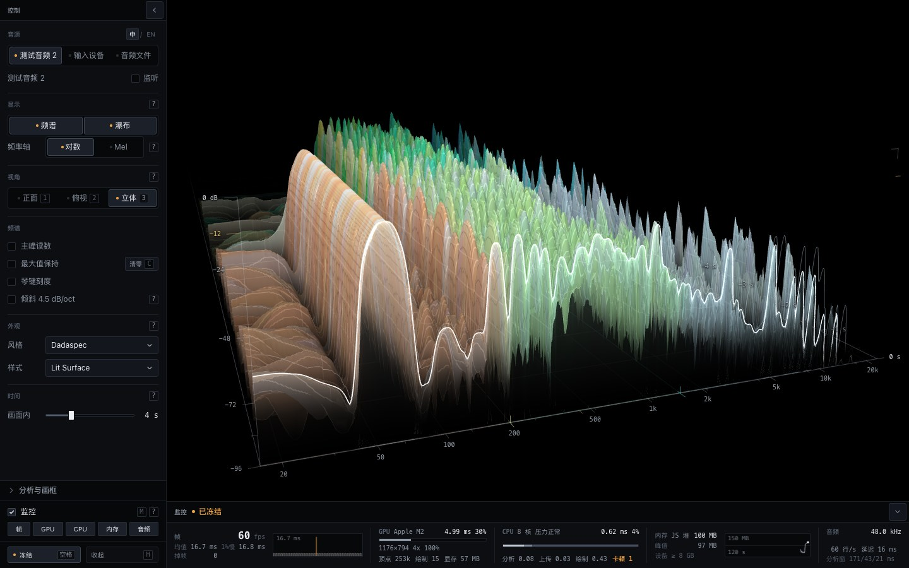
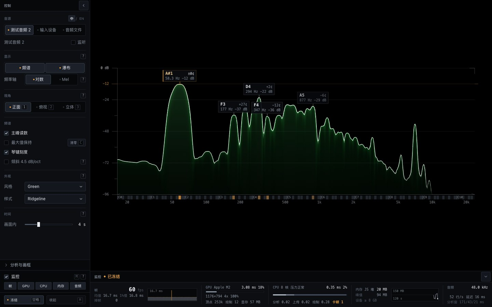

# Spectrum 3D

[English](../README.md) | **简体中文** | [日本語](README.ja.md)

[](https://github.com/lawchli/Spectrum-3D/releases)
[](../LICENSE)
[](https://github.com/lawchli/Spectrum-3D/actions/workflows/release.yml)

面向浏览器、Android 和桌面端的实时三维音频频谱仪。声音化作瀑布地形向后滚动，最前沿是实时频谱。从正面看是频谱仪，俯视是频谱图，斜看是一片地形。

**[在浏览器中打开](https://lawchli.github.io/Spectrum-3D/)**，点击**测试音频**，然后拖动旋转、滚轮缩放。无需安装。


<p>
  
  
  
</p>

从左到右：Dadaspec 风格的立体视角、Mel 风格在 Mel 频率轴上的俯视视角，以及带主峰读数和琴键刻度的 Green 风格正面视角。

## 功能

- 三种视角：正面、俯视和立体。切换视角时相机平滑移动，并可自由旋转、平移和缩放。
- 音高一目了然：带音名和音分的主峰读数、频率轴下方的琴键刻度、最大值保持，以及可选的每倍频程 4.5 dB 倾斜。
- 对数或 Mel 频率轴，每秒 60 到 480 行频谱，每半音 1 到 8 段。
- 四种风格（Tungsten、Mel、Green、Dadaspec），每种均可绘制为 Lit Surface、Ridgeline、Mesh 或 Solid。
- 音源：内置测试音频、麦克风或音频接口、音频文件。Android 示例应用还支持采集系统音频（Android 10 及以上）。
- 性能监控：显示帧时间、GPU 与 CPU 耗时、内存和音频速率。
- 支持中英文界面。

## 平台

| | 说明 | 状态 |
|---|---|---|
| 网页版 | 零依赖的 WebGL2 页面 | Beta。已在 macOS 上的 Chrome、Safari、Firefox 及 Android 上的 Chrome 中测试 |
| Android | 可嵌入的 Kotlin / OpenGL ES 3.0 库（AAR），以及一个示例应用 | 预览版。仅在一台手机上测试过。暂不支持 Dadaspec 风格、Mel 轴、倾斜和音频文件 |
| 桌面端 | 面向 macOS、Windows 和 Linux 的 Rust / wgpu 程序 | macOS：Beta。Windows 和 Linux：实验阶段 |

三端共用同一套 GLSL 着色器和分析算法，在 80 个参考场景上交叉校验，并以同一版本号同步发布。

## 下载

前往 [Releases](https://github.com/lawchli/Spectrum-3D/releases) 下载对应文件：

| 文件 | 适用平台 |
|---|---|
| `Spectrum-3D-<version>-macos-universal.zip` | macOS 11 及以上，Apple Silicon 与 Intel |
| `Spectrum-3D-<version>-windows-x64.zip` | Windows 10 及以上，64 位 |
| `Spectrum-3D-<version>-linux-x64.tar.gz` | Linux x86-64，glibc 2.35 及以上（例如 Ubuntu 22.04） |
| `Spectrum-3D-<version>-android.apk` | Android 示例应用，Android 8.0 及以上 |
| `spectrum-3d-<version>.aar` | Android 库 |

桌面端发行包未使用付费开发者证书签名，首次启动时系统会弹出确认提示：

- **macOS**：解压后将 `Spectrum 3D.app` 移至任意位置，右键点击并选择“打开”。在 macOS 15 及以上系统中，先尝试打开一次，然后在“系统设置”>“隐私与安全性”中点击“仍要打开”。也可以自行清除下载标记：`xattr -dr com.apple.quarantine "Spectrum 3D.app"`。
- **Windows**：完整解压整个文件夹后运行 `Spectrum 3D.exe`。如果出现 SmartScreen 提示，点击“更多信息”，然后选择“仍要运行”。
- **Linux**：解压后运行 `bin/spectrum-3d`。`./install.sh` 会将其添加到应用菜单（仅对当前用户生效），`./install.sh --remove` 可将其移除。需要 Vulkan 或 OpenGL 驱动；在 X11 下还需要 `libxkbcommon-x11`，在 Debian 和 Ubuntu 上可通过 `sudo apt-get install libxkbcommon-x11-0` 安装。

## 使用 Android 库

将 `spectrum-3d-<version>.aar` 放入应用的 `libs/` 目录，并添加 `implementation(files("libs/spectrum-3d-<version>.aar"))`。它需要 Android 8.0（API 26）和 OpenGL ES 3.0，不依赖 Compose，也不申请任何权限：不会自行录音，而是由你传入 PCM 数据。

```kotlin
val spectrum = SpectrumController(context, SpectrumConfiguration(palette = "green"))
val spectrumView = SpectrumView(context, spectrum)  // 添加到你的布局中
spectrum.startPcm(sampleRate = 48000)

// 在你的播放器、解码器或采集回调中调用：
spectrum.pushPcm(interleavedStereo, channels = 2)
```

生命周期管理、Compose 封装、采集辅助工具及完整 API 见 [android/README.md](../android/README.md)。

## 从源码构建

所有部分均可仅凭本仓库完成构建。三端都需要 [Node.js](https://nodejs.org) 22 或更高版本；无需安装任何依赖包，脚本仅使用 Node 自带的模块。

**网页版**：纯静态页面，无需构建步骤。用任意静态文件服务器托管 `web/` 目录并打开 <http://localhost:8765>。麦克风需要安全上下文：`localhost` 可直接工作，其他地址必须使用 HTTPS。

```sh
python3 scripts/serve-web.py
```

**桌面端**：需要 [Rust](https://rustup.rs) 稳定版。

```sh
bash scripts/wgpu-app.sh               # macOS：rust/target/bundle/Spectrum 3D.app
bash scripts/wgpu-windows-package.sh   # Windows（在 Git Bash 中）：rust/target/bundle/Spectrum 3D/
bash scripts/wgpu-linux-package.sh     # Linux：rust/target/bundle/spectrum-3d-linux/
```

在 Linux 上需先安装开发库（Debian 和 Ubuntu 包名）：

```sh
sudo apt-get install -y pkg-config libasound2-dev libudev-dev libx11-dev libxcursor-dev libxrandr-dev libxi-dev libxinerama-dev libxkbcommon-dev libwayland-dev libegl1-mesa-dev libgl1-mesa-dev
```

如需不打包直接从源码树运行：

```sh
node scripts/export-shared.mjs
node scripts/shader-migrate.mjs
cargo run --manifest-path rust/Cargo.toml -p spectrum-wgpu --release
```

**Android**：需要 JDK 17，以及包含 `platforms;android-36` 和 `build-tools;36.0.0` 的 Android SDK。库文件生成在 `android/spectrum/build/outputs/aar/`，示例应用生成在 `android/app/build/outputs/apk/debug/`。

```sh
export SPECTRUM_ANDROID_HOME=/path/to/android-sdk
bash scripts/android-build.sh :spectrum:assembleRelease :app:assembleDebug
```

**测试**：

```sh
node --test tests/analysis.test.mjs tests/monitor.test.mjs
python3 scripts/web-check.py
cargo test --manifest-path rust/Cargo.toml --release
bash scripts/android-build.sh :spectrum:testDebugUnitTest
```

## 已知问题

目前仍处于 Beta 阶段。

- **iPhone 和 iPad 上的网页版**：打开静音开关时，“监听”没有声音。请暂时关闭静音模式。
- **应用内置浏览器中的网页版**：开启“监听”时切离页面可能会发出一声爆音。在 iOS 和 Android 的微信、QQ 浏览器中均遇到过。
- **4K 显示器配集成显卡**：最高设置（每秒 480 行、每半音 8 段、4× 抗锯齿）下约每秒 30 帧。调低渲染比例，或在桌面端关闭抗锯齿，可恢复到接近 60 帧。
- **Windows**：在 Intel UHD 730 上无论采用何种设置，帧率都停留在 33 左右；在双显卡设备上会使用集成显卡；将 WAV 或 FLAC 文件拖放到窗口中会导致窗口无响应（使用“音频文件”按钮则可正常打开）。
- **Windows 和 Linux 发行包**仅通过软件渲染自动测试，未在真机上手动测试。
- **Android** 仅在一台手机上测试过（Sony XZ1 Compact，Android 16）。抗锯齿默认关闭，因为开启 4× 会导致该手机的 GPU 驱动崩溃。
- **macOS 和 Windows 发行包**未经签名或公证。

发现了其他问题？欢迎[提交 Issue](https://github.com/lawchli/Spectrum-3D/issues)。

## 许可证与致谢

Spectrum 3D 基于 [MIT 许可证](../LICENSE) 发布。

Dadaspec 风格的名称和着色思路源自 dadabots 的 [dadaspec](https://github.com/dada-bots/dadaspec)（MIT 许可证）。本项目未包含任何 dadaspec 代码，也与 dadabots 无关联。详见 [THIRD-PARTY-NOTICES.md](../THIRD-PARTY-NOTICES.md)。桌面端发行包在 `THIRD-PARTY-LICENSES.txt` 中列出了构建所用的 Rust crate 许可证。
