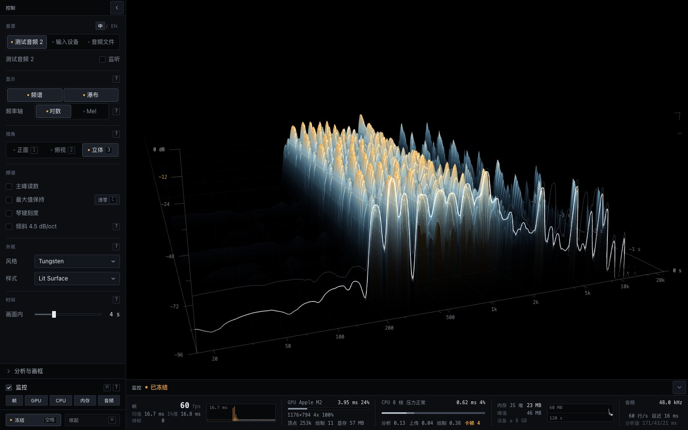
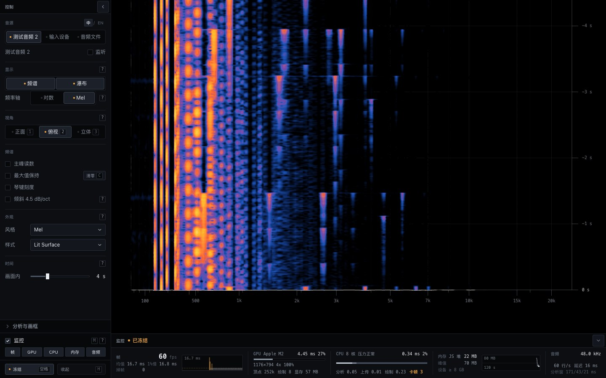

# Spectrum 3D

[English](../README.md) | **简体中文** | [日本語](README.ja.md)

[](https://github.com/lawchli/Spectrum-3D/releases)
[](../LICENSE)
[](https://github.com/lawchli/Spectrum-3D/actions/workflows/release.yml)

实时三维音频频谱仪，网页、安卓和桌面端都能用。声音会随着时间往后流成一片瀑布地形，最前沿始终是当前的实时频谱。正对着看是频谱仪，从正上方俯视是语谱图，斜着拉一个角度看就是一块起伏的地形。

**[在浏览器里打开](https://lawchli.github.io/Spectrum-3D/)**，点一下“测试音频”，拖动旋转、滚轮缩放就可以看效果，什么都不用装。



| Dadaspec 风格，立体 | Mel 风格，俯视，Mel 频率轴 | Green 风格，正面，开着主峰读数 |
|---|---|---|
|  |  |  |

## 功能

- 正面、俯视、立体三个视角之间切起来镜头会平滑过渡，看的时候也能自己旋转、平移和缩放。
- 看音高很顺手：主峰读数会直接标出音名和音分，频率刻度底下带了一排琴键刻度，还有最大值保持；需要的话也可以打开每倍频程 4.5 dB 的倾斜。
- 频率轴可以在对数和 Mel 之间切换，每秒能画 60 到 480 行频谱，每个半音可以分 1 到 8 个频段。
- 内置 Tungsten、Mel、Green、Dadaspec 四套风格，每套都能按 Lit Surface、Ridgeline、Mesh 或 Solid 四种画法来渲染。
- 声音来源可以是内置测试音频、麦克风或声卡，也可以直接选音频文件。如果你用的是安卓演示 App，在 Android 10 及以上系统里还能直接录手机内部播放的声音。
- 带一个性能监控面板，实时看每帧耗时、GPU 和 CPU 时间、内存以及音频行速率。
- 界面本身有英文和中文两种语言。

## 平台

| | 说明 | 状态 |
|---|---|---|
| 网页版 | 不依赖任何第三方库的 WebGL2 页面 | Beta。在 macOS 的 Chrome、Safari、Firefox 以及安卓的 Chrome 上测过 |
| 安卓 | 可以嵌进自己 App 里的 Kotlin / OpenGL ES 3.0 组件库（AAR），另附一个演示 App | 预览版。只在一台手机上测过。还没有 Dadaspec 风格、Mel 轴和倾斜，也还不能打开音频文件 |
| 桌面版 | 用 Rust / wgpu 写的程序，有 macOS、Windows 和 Linux 版 | macOS 是 Beta；Windows 和 Linux 目前是实验性质 |

三端共用同一份 GLSL 着色器和同一套分析算法，会拿 80 个参考场景互相对照校验，每次也都会用同一个版本号一起发布。

## 下载

文件都在 [Releases](https://github.com/lawchli/Spectrum-3D/releases) 页面里：

| 文件 | 适用范围 |
|---|---|
| `Spectrum-3D-<version>-macos-universal.zip` | macOS 11 及以上，Apple 芯片和 Intel 都支持 |
| `Spectrum-3D-<version>-windows-x64.zip` | 64 位 Windows 10 及以上 |
| `Spectrum-3D-<version>-linux-x64.tar.gz` | x86-64 架构的 Linux，需要 glibc 2.35 及以上，比如 Ubuntu 22.04 |
| `Spectrum-3D-<version>-android.apk` | 安卓演示 App，需要 Android 8.0 及以上 |
| `spectrum-3d-<version>.aar` | 安卓组件库 |

因为桌面端安装包没有用付费的开发者证书签名，第一次打开时系统都会拦一下：

- **macOS**：解压后把 `Spectrum 3D.app` 放到你习惯的位置，右键点它选“打开”。在 macOS 15 及以上系统里，得先试着打开一次，再去“系统设置”的“隐私与安全性”里点“仍要打开”。嫌麻烦的话也可以自己清掉下载标记：`xattr -dr com.apple.quarantine "Spectrum 3D.app"`。
- **Windows**：把整个文件夹解压出来，运行里面的 `Spectrum 3D.exe`。如果弹出 SmartScreen 提示，点“更多信息”，再点“仍要运行”。
- **Linux**：解包后直接运行 `bin/spectrum-3d`。想放进应用菜单可以执行 `./install.sh`（只对当前用户生效），想删掉就跑 `./install.sh --remove`。程序需要 Vulkan 或 OpenGL 驱动；如果跑在 X11 下，还得装 `libxkbcommon-x11`，Debian 和 Ubuntu 上运行 `sudo apt-get install libxkbcommon-x11-0` 就好。

## 在自己的 App 里用安卓组件库

把 `spectrum-3d-<version>.aar` 放进 App 的 `libs/` 目录，然后在依赖里加上 `implementation(files("libs/spectrum-3d-<version>.aar"))`。它要求 Android 8.0（API 26）和 OpenGL ES 3.0，不依赖 Compose，也不会申请任何权限——它自己不录音，需要你把 PCM 数据喂给它。

```kotlin
val spectrum = SpectrumController(context, SpectrumConfiguration(palette = "green"))
val spectrumView = SpectrumView(context, spectrum)  // 加到你的布局里
spectrum.startPcm(sampleRate = 48000)

// 在你的播放器、解码器或录音回调里把数据送进来：
spectrum.pushPcm(interleavedStereo, channels = 2)
```

生命周期怎么接、Compose 的封装、采集辅助类以及完整的接口说明，都在 [android/README.md](../android/README.md)（英文）里。

## 从源码构建

网页、桌面和安卓都在这一个仓库里直接构建。三端都要用到 [Node.js](https://nodejs.org) 22 及以上版本，不过脚本只用 Node 自带模块，不用额外装任何包。

**网页版**：静态页面，不用编译。用任意静态文件服务器把 `web/` 目录托管起来，然后打开 <http://localhost:8765> 就行。如果要用麦克风，页面必须跑在安全上下文里：`localhost` 可以直接用，换别的地址就必须走 HTTPS。

```sh
python3 scripts/serve-web.py
```

**桌面版**：需要先装好 [Rust](https://rustup.rs) stable 工具链。

```sh
bash scripts/wgpu-app.sh               # macOS：rust/target/bundle/Spectrum 3D.app
bash scripts/wgpu-windows-package.sh   # Windows（在 Git Bash 里运行）：rust/target/bundle/Spectrum 3D/
bash scripts/wgpu-linux-package.sh     # Linux：rust/target/bundle/spectrum-3d-linux/
```

在 Linux 上编译前需要先装系统的开发库（Debian 和 Ubuntu 的包名如下）：

```sh
sudo apt-get install -y pkg-config libasound2-dev libudev-dev libx11-dev libxcursor-dev libxrandr-dev libxi-dev libxinerama-dev libxkbcommon-dev libwayland-dev libegl1-mesa-dev libgl1-mesa-dev
```

不想打安装包的话，也可以直接从源码跑起来：

```sh
node scripts/export-shared.mjs
node scripts/shader-migrate.mjs
cargo run --manifest-path rust/Cargo.toml -p spectrum-wgpu --release
```

**安卓**：需要 JDK 17，以及装有 `platforms;android-36` 和 `build-tools;36.0.0` 的 Android SDK。编出来的组件库会落在 `android/spectrum/build/outputs/aar/`，演示 App 在 `android/app/build/outputs/apk/debug/`。

```sh
export SPECTRUM_ANDROID_HOME=/path/to/android-sdk
bash scripts/android-build.sh :spectrum:assembleRelease :app:assembleDebug
```

**测试**：

```sh
node --test tests/analysis.test.mjs tests/monitor.test.mjs
python3 scripts/web-check.py
cargo test --manifest-path rust/Cargo.toml --release
bash scripts/android-build.sh :spectrum:testDebugUnitTest
```

## 已知问题

现在还是 Beta 版。

- **iPhone 和 iPad 上的网页版**：如果机子侧面的静音开关开着，就算打开了“监听”也不会有声音。目前只能先关掉静音模式。
- **App 内置浏览器里的网页版**：开着“监听”时从页面切走，可能会响一声爆音。在 iOS 和安卓的微信、QQ 内置浏览器里都遇到过这个问题。
- **核显接 4K 显示器**：用到最高设置（每秒 480 行、每半音 8 个频段、4 倍抗锯齿）时大概只有 30 帧左右。把渲染比例调低一点，或者在桌面版里关掉抗锯齿，帧率就能回到接近 60 帧。
- **Windows**：在 Intel UHD 730 上无论怎么调设置，帧率都在 33 帧上下；有两块显卡的机器默认会用核显；另外把 WAV 或 FLAC 文件直接拖到窗口上会导致程序卡死，改用“音频文件”按钮打开就没有问题。
- **Windows 和 Linux 安装包**只在自动化流程里用软件渲染测过，还没有在真机上手动测过。
- **安卓**我只在一台手机上测过（Sony XZ1 Compact，Android 16）。在这台手机上开 4 倍抗锯齿会把显卡驱动搞崩，所以默认把抗锯齿关掉了。
- **macOS 和 Windows 安装包**都没有签名和公证。

遇到其他问题的话，欢迎[提一个 Issue](https://github.com/lawchli/Spectrum-3D/issues)。

## 许可和致谢

Spectrum 3D 使用 [MIT 许可证](../LICENSE)。

Dadaspec 风格的名字和配色思路来自 dadabots 的 [dadaspec](https://github.com/dada-bots/dadaspec)（MIT 许可证）。本项目没有包含 dadaspec 的代码，也和 dadabots 没有任何关系，具体说明见 [THIRD-PARTY-NOTICES.md](../THIRD-PARTY-NOTICES.md)。桌面版安装包里的 `THIRD-PARTY-LICENSES.txt` 列出了构建时用到的 Rust crate 的许可证。
